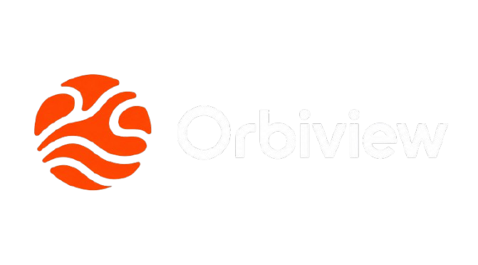
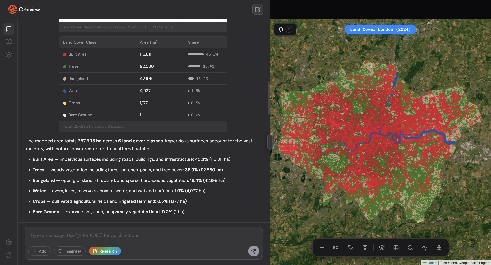
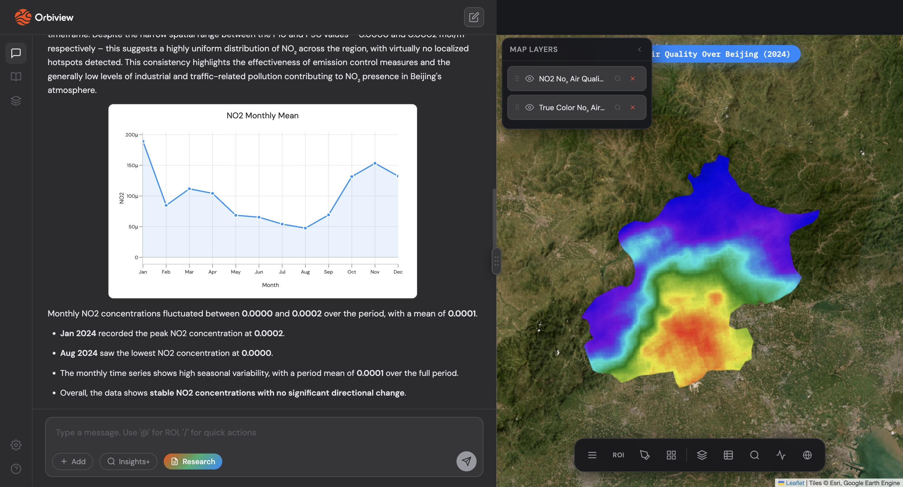
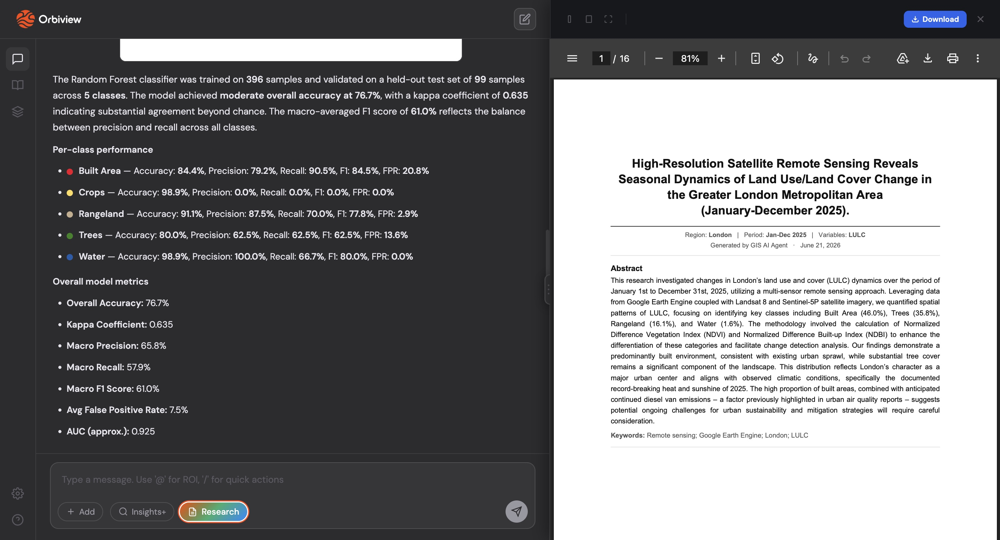
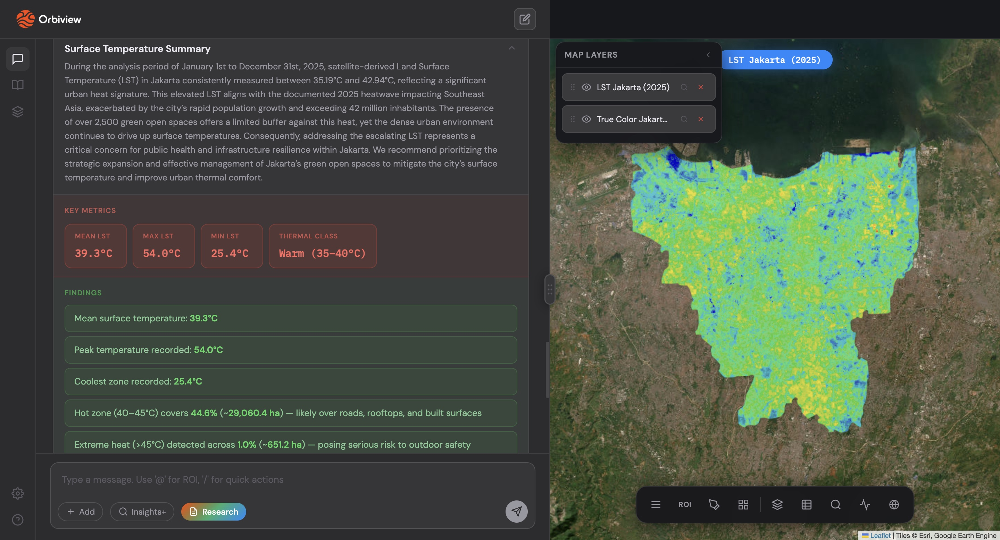

# Orbiview — GIS AI Agent

<div align="center">
  

  
  
  
  
  
  
  
  

</div>

## Demo
 
https://github.com/user-attachments/assets/4f466034-3686-41f8-b3a8-3fcb601ddf15

## Overview

**Orbiview** is a geospatial AI agent that turns natural-language prompts into satellite imagery analysis. Ask about vegetation health, pollution levels, land cover change, or urban heat for a region and time range — Orbiview uses **Google Earth Engine** for geospatial processing and **Groq** for language-model reasoning, then returns interactive maps, charts, and narrative insights. The default Groq model is `openai/gpt-oss-120b`; local Ollama is no longer required. This is a provider migration, not a claim that the models are equivalent.

Try the public demo: [Orbiview on Vercel](https://gis-ai-agent.vercel.app/). The interface is a split-panel web app: a chat panel for queries on one side, an interactive Leaflet map on the other — with support for custom ROI drawing, multi-year comparisons, and downloadable PDF research reports. No visitor password is required.

## Key Features

- 🗨️ **Chat interface** — ask questions in plain language; chat history stays in the browser while signed sessions isolate Redis-backed server results
- 🧠 **LangGraph agent** — structured multi-step reasoning with a live plan widget showing agent progress, powered by Groq
- 🗺️ **Interactive map** — Leaflet.js + ESRI satellite basemap
- ✏️ **Draw your own ROI** — polygon or rectangle, name it, and reference it in chat with `@name`
- 📊 **19 GIS indices** — vegetation, water, urban, thermal, and atmospheric analysis (see table below)
- 🖼️ **Image overlays** — analysis results rendered as georeferenced JPG overlays on the map
- 📈 **Plotly visualizations** — monthly trend lines, LULC pie/bar charts, rendered inline in chat
- 📅 **Multi-year analysis** — per-year map tile layers plus combined comparison chart grids
- 🧾 **PDF research reports** — full report generation with formulas, figure descriptions, and ML metrics (accuracy, per-class metrics, confusion matrix for LULC)
- 🗂️ **Layer manager** — toggle visibility, zoom to, or remove any analysis layer
- 📚 **Knowledge Base** — in-app documentation page covering all 19 indices, with scroll-spy navigation and category accent colors

## Architecture

```
Browser request
    │
    ▼
app.py (Flask) ──► worker.py ──► analysis.py ──► Google Earth Engine
    │                    │              └──────► Groq (language tasks)
    │                    └──► research_agent.py ──► PDF report (ReportLab)
    └──► Redis-backed session results / streamed progress
             │
             ▼
templates/index.html + public/static/js/app.js ──► Chat + Leaflet map + Plotly charts

agent.py remains a separate LangGraph command-line entry point.
```

## Supported GIS Indices

| Category | Indices |
|---|---|
| 🌱 Vegetation | NDVI, EVI, SAVI |
| 💧 Water | NDWI, MNDWI |
| 🏙️ Built-up / Urban | NDBI, UI, BSI, NBI |
| 🌡️ Thermal | LST, UHI |
| ❄️ Snow | NDSI |
| 🌫️ Atmospheric / Air Quality | NO₂, CO, SO₂, CH₄, Aerosol, FFPI |
| 🗺️ Land Cover | LULC (with classification accuracy metrics) |

## Tech Stack

**Backend:** Flask · LangGraph · Groq · Google Earth Engine Python API · ReportLab
**Frontend:** Vanilla JavaScript · Leaflet.js · Plotly.js · HTML5 · CSS3

## Project Structure

```
gis-ai-agent/
├── app.py                      # Public Flask routes and API
├── analysis.py                 # Web analysis pipeline
├── agent.py                    # LangGraph CLI entry point
├── worker.py                   # Isolated GIS/report worker process
├── llm.py                      # Groq API transport
├── gee_auth.py                 # Earth Engine service-account setup
├── gis_functions.py            # GEE analysis functions
├── research_agent.py           # PDF report generation (ReportLab)
├── storage.py                  # Redis sessions, results, and limits
├── config.py                   # App configuration / environment settings
├── public/assets/              # Images and static assets
├── public/static/              # Frontend CSS and JavaScript
├── templates/index.html        # Chat and map interface
├── .env.example                # Safe environment-variable template
├── vercel.json                 # Flask function configuration
└── docs/VERCEL_DEPLOYMENT.md   # Deployment and operations guide
```

## Deployment and local development

See [Vercel setup](docs/VERCEL_DEPLOYMENT.md) for the hosted public demo,
required environment variables, Earth Engine authentication and usage limits.

```bash
python3.12 -m venv .venv
source .venv/bin/activate
pip install -r requirements.txt
cp .env.example .env.local
# Fill in your own credentials in .env.local; never commit them.
python app.py
```

Open http://localhost:8000. Set the values from `.env.example` in `.env.local`:
Groq API key, registered Earth Engine project ID and service-account JSON,
application signing key, and Upstash Redis REST URL/token. The Vercel Marketplace
`KV_REST_API_URL` and `KV_REST_API_TOKEN` aliases are also supported. Never commit
`.env.local` or service-account credentials. The default model is
`openai/gpt-oss-120b` on Groq; local Ollama is no longer required. See the
[deployment guide](docs/VERCEL_DEPLOYMENT.md) for Earth Engine setup, limits,
troubleshooting, and end-to-end verification.

## Usage Examples

### Machine Learning
- User: "Show me the land cover of London in 2024"
- Orbiview: Understand the user's request, perform machine learning in GEE, and present the results with insights



### Trend Analysis
- User: "Analyze No2 air quality over Beijing in 2024"
- Orbiview: Creates visualization and identifies key patterns



### Research Agent
- User: "Analyze the 2025 land cover of London and generate a comprehensive research paper"
- Orbiview: Activate research mode, generate a research paper, and present the results



### Insights Summary
- User: "Analyze the land surface temperature of Jakarta in 2025"
- SmartLook: Generate an insights summary section with recommendations based on the analysis



## PDF Research Reports

Orbiview can generate a full downloadable PDF report for any analysis, including the formulas used, figure descriptions, and — for LULC classification — a complete accuracy breakdown (overall accuracy, per-class metrics, and confusion matrix).

## Acknowledgments

- Google Earth Engine for satellite data infrastructure
- The LangChain / LangGraph team for the agent framework
- Groq for hosted language-model inference
- Leaflet.js and Plotly.js for mapping and visualization

## License

See the [LICENSE](LICENSE) file for details.
---
If you find Orbiview useful, please consider giving it a star! ⭐

**Built for fast, conversational geospatial analysis**
